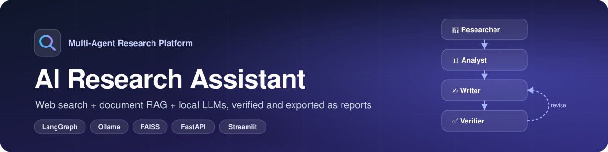
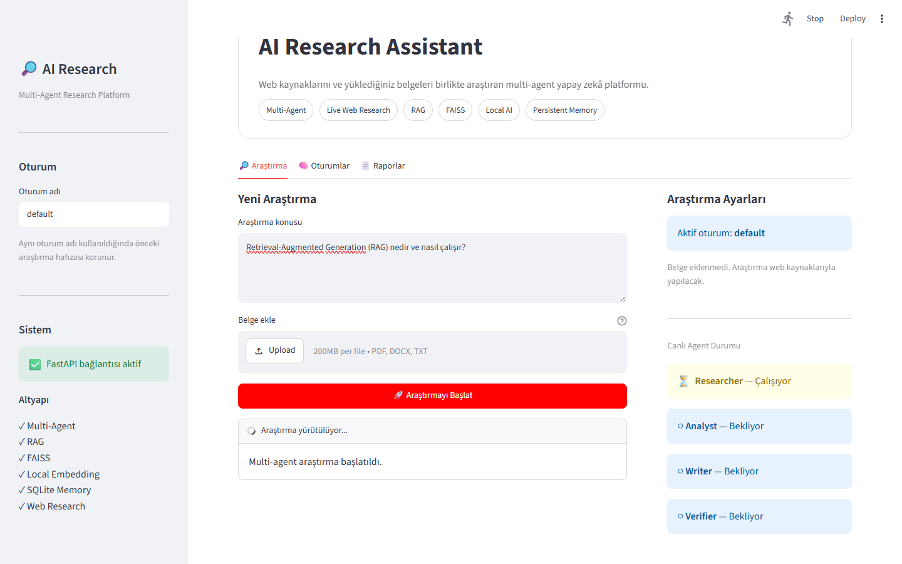
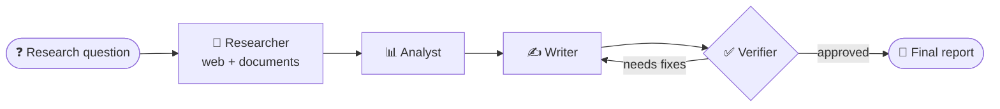
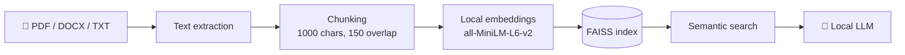
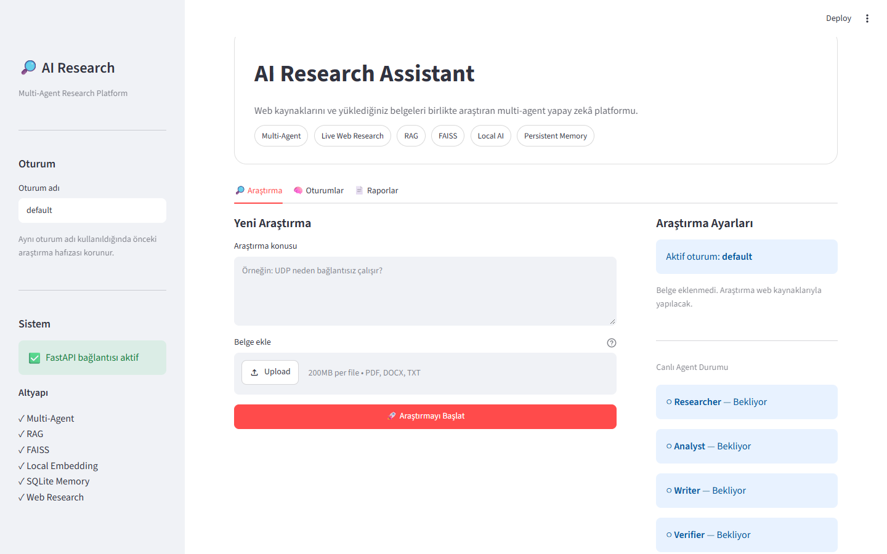

<div align="center">



<br>
<br>


**[✨ Features](#-features)** · **[🧠 How It Works](#-how-it-works)** · **[🚀 Quick Start](#-quick-start)** · **[🐳 Docker](#-docker)** · **[🔌 API](#-api)**

<br>



</div>

---

## 📖 About

**AI Research Assistant** answers research questions with a team of four AI agents. It searches the web, reads your own PDF, DOCX, or TXT documents, writes a structured report, checks it, and revises it when needed. Reports can be exported as PDF or DOCX.

> [!TIP]
> **Runs fully locally. No API keys required.** The language model runs on your machine through [Ollama](https://ollama.com), embeddings are computed locally, and web search uses DuckDuckGo.

---

## ✨ Features

| | Feature | Details |
|---|---|---|
| 🤖 | **Multi-agent workflow** | Researcher, Analyst, Writer, and Verifier agents orchestrated with LangGraph |
| 🌐 | **Live web research** | Searches the web and reads the top sources for every query |
| 📄 | **Document RAG** | Upload PDF, DOCX, or TXT files; relevant passages are retrieved with FAISS |
| ✅ | **Self-verification** | The Verifier checks the report and sends it back to the Writer if it needs fixes |
| 💾 | **Persistent memory** | Sessions, conversations, and past research are stored in SQLite |
| 💬 | **Follow-up questions** | Ask about a finished report using the session's context |
| 📊 | **Live agent status** | Watch each agent move from *waiting* to *running* to *done* in real time |
| 📑 | **Report export** | Download results as Markdown, PDF, or DOCX |
| 🐳 | **Docker ready** | One command starts both the API and the web interface |

---

## 🧠 How It Works

### Agent workflow



| Agent | Role |
|---|---|
| 🔎 **Researcher** | Searches the web and, if a document was uploaded, retrieves its most relevant passages |
| 📊 **Analyst** | Picks out the information that matters for the question |
| ✍️ **Writer** | Turns the analysis into a structured report |
| ✅ **Verifier** | Checks the report for consistency and source support; requests a revision if needed (at most once, configurable) |

### Document RAG pipeline

Instead of sending a whole document to the model, only the most relevant parts are used:



---

## 🛠️ Tech Stack

| Layer | Technologies |
|---|---|
| **Agents** | LangGraph, LangChain |
| **LLM** | Ollama (default model: `qwen3:4b-instruct`) |
| **Retrieval** | Sentence Transformers (`all-MiniLM-L6-v2`), FAISS |
| **Web search** | DuckDuckGo (`ddgs`), BeautifulSoup |
| **Backend** | FastAPI, Uvicorn |
| **Frontend** | Streamlit |
| **Storage** | SQLite |
| **Documents** | pypdf, python-docx |
| **Reports** | ReportLab (PDF), python-docx (DOCX) |
| **Testing** | Pytest |
| **Deployment** | Docker, Docker Compose |

---

## 🚀 Quick Start

### Prerequisites

- **Python 3.10+**
- **[Ollama](https://ollama.com/download)** with the default model pulled:

```bash
ollama pull qwen3:4b-instruct
```

### 1. Clone and install

```bash
git clone https://github.com/betulaltunyuva/ai-research-assistant.git
cd ai-research-assistant
python -m venv .venv
```

Activate the virtual environment:

| Windows (PowerShell) | macOS / Linux |
|---|---|
| `.venv\Scripts\activate` | `source .venv/bin/activate` |

Then install the dependencies:

```bash
pip install -r requirements.txt
```

### 2. Run

The app has two parts, so open two terminals:

```bash
# Terminal 1: API
uvicorn api:api --reload
```

```bash
# Terminal 2: Web interface
streamlit run web_app.py
```

| Service | Address |
|---|---|
| 🖥️ Web interface | http://localhost:8501 |
| 📚 API docs (Swagger) | http://127.0.0.1:8000/docs |

Enter a research question, optionally attach a document, and press **Araştırmayı Başlat** (Start Research):



> [!NOTE]
> The first run downloads the embedding model (~90 MB) from Hugging Face.

### ⚙️ Configuration

Model and research settings live in [`settings.py`](settings.py):

| Setting | Default | Description |
|---|---|---|
| `MODEL_NAME` | `qwen3:4b-instruct` | Ollama model used by the agents |
| `SEARCH_RESULT_COUNT` | `3` | Web sources read per query |
| `MAX_REVISIONS` | `1` | How many times the Verifier can send a report back |
| `MODEL_TEMPERATURE` | `0` | Lower values give more consistent answers |

Environment variables:

| Variable | Default | Used by |
|---|---|---|
| `OLLAMA_BASE_URL` | `http://127.0.0.1:11434` | API: where Ollama is running |
| `API_URL` | `http://127.0.0.1:8000` | Web interface: where the API is running |

---

## 🐳 Docker

Docker Compose starts two containers: `ai-research-api` (port 8000) and `ai-research-web` (port 8501). Ollama keeps running on your host machine.

```bash
docker compose up -d --build
```

```bash
docker compose ps     # check the containers
docker compose down   # stop everything
```

Settings in an optional `.env` file are passed to both containers. Docker Compose v2.24 or newer is required.

Inside Docker, the API reaches Ollama at `http://host.docker.internal:11434`. Uploaded documents and reports are stored in the `documents/` and `outputs/` folders on your machine.

---

## 🔌 API

Full interactive documentation is available at **http://127.0.0.1:8000/docs**.

| Method | Endpoint | Description |
|---|---|---|
| `GET` | `/health` | Health check |
| `POST` | `/upload` | Upload a PDF, DOCX, or TXT document |
| `POST` | `/research` | Run a research and wait for the result |
| `POST` | `/research/start` | Start a research in the background and get a `job_id` |
| `GET` | `/research/status/{job_id}` | Poll the live status of each agent |
| `POST` | `/ask` | Ask a follow-up question within a session |
| `GET` | `/sessions` | List research sessions |
| `GET` | `/reports` | List saved reports |

<details>
<summary><b>Example request</b></summary>

```bash
curl -X POST http://127.0.0.1:8000/research/start \
  -H "Content-Type: application/json" \
  -d '{"query": "What is Retrieval-Augmented Generation?", "session_id": "demo"}'
```

</details>

---

## 🔐 Security

- **No secrets needed.** The app does not use any API keys. `.env` is ignored by Git in case you add your own settings.
- **Uploads stay in their folder.** The API only accepts documents from `documents/uploads/`, so a request cannot make the assistant read other files on the server.
- **Local data stays local.** Uploaded documents, reports, and the memory database are excluded from Git.

---

## 🧪 Tests

```bash
python -m pytest tests -q
```

The test suite covers document reading, text chunking, FAISS retrieval, memory, agent status, report export, agent routing, web search, and upload-path validation.

<details>
<summary><b>📁 Project Structure</b></summary>

```text
ai-research-assistant/
├── agents/                # Researcher, Analyst, Writer, Verifier
├── utils/
│   ├── web_search.py      # DuckDuckGo search
│   ├── page_reader.py     # Reads web pages
│   ├── document_reader.py # PDF / DOCX / TXT parsing
│   ├── text_chunker.py    # Splits text into chunks
│   ├── embedding.py       # Local embeddings
│   ├── vector_store.py    # FAISS index
│   ├── document_rag.py    # Retrieval over uploaded documents
│   ├── conversation_memory.py  # SQLite memory
│   ├── agent_status.py    # Live job and agent status
│   ├── report_saver.py    # Saves Markdown reports
│   ├── report_exporter.py # PDF / DOCX export
│   └── system_check.py    # Checks that Ollama is ready
├── tests/                 # Pytest suite
├── docs/images/           # README images
├── api.py                 # FastAPI backend
├── web_app.py             # Streamlit interface
├── main.py                # LangGraph workflow (also runs as a CLI)
├── settings.py            # Model and research settings
├── Dockerfile
└── docker-compose.yml
```

</details>

---

## 🗺️ Roadmap

- [x] Multi-agent research with automatic verification
- [x] Document RAG with FAISS
- [x] Persistent memory and follow-up questions
- [x] PDF and DOCX export
- [x] Docker support
- [ ] Streaming responses
- [ ] Source credibility scoring
- [ ] Better citation checking
- [ ] User authentication
- [ ] Search over research history
- [ ] More LLM providers

---

## 📄 License

This project is licensed under the [MIT License](LICENSE).

---

<div align="center">

### 👩‍💻 Betül Altunyuva

Software Engineering Student

[](https://github.com/betulaltunyuva)
[](https://betulaltunyuva.github.io/react-typescript-web-lab/)

</div>
